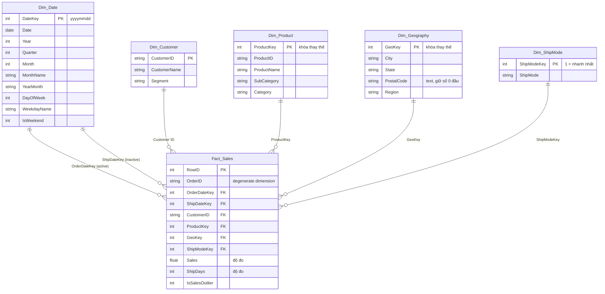

# Lược đồ sao (Star Schema): Superstore Sales 2015–2018

Dữ liệu sinh bởi `etl/build_star_schema.py`, nằm trong thư mục `data/star/`. Kết quả kiểm tra toàn vẹn xem ở `docs/Kiem_tra_star_schema.md`.

## Vai trò các bảng

| Bảng | Loại | Hạt (grain) / nội dung | Số dòng |
|---|---|---|---|
| Fact_Sales | Fact | Mỗi dòng là một dòng hàng trong một đơn hàng. Độ đo: Sales, Ship Days | 9.799 |
| Dim_Customer | Dimension | Khách hàng và phân khúc (Consumer, Corporate, Home Office) | 793 |
| Dim_Product | Dimension | Sản phẩm, phân cấp Category → Sub-Category → Product | 1.893 |
| Dim_Geography | Dimension | Địa điểm giao hàng, phân cấp Region → State → City | 628 |
| Dim_Date | Dimension | Lịch ngày 2015-01-01 → 2019-12-31, phân cấp Year → Quarter → Month → Day | 1.826 |
| Dim_ShipMode | Dimension | Phương thức giao hàng, xếp theo tốc độ | 4 |

## Ghi chú thiết kế

- **Khóa thay thế (surrogate key)**:
  - `ProductKey` được tạo trên cặp (Product ID, Product Name), vì 32 Product ID ứng với nhiều tên.
  - `GeoKey` được tạo trên (City, State, Postal Code), vì mã 92024 ứng với 2 thành phố và 55 tên thành phố có mặt ở nhiều bang.
- **Order ID** để lại trong Fact dưới dạng degenerate dimension. Dùng nó để đếm số đơn bằng `DISTINCTCOUNT(Fact_Sales[Order ID])`.
- **Dim_Date đóng hai vai trò (role-playing)**: ngày đặt hàng là quan hệ active, ngày giao hàng là quan hệ inactive (dùng qua `USERELATIONSHIP`). Bảng phủ đến hết 2019 vì Ship Date muộn nhất là 2019-01-05.
- Các phân cấp trong Dim phục vụ thao tác OLAP drill-down: Year → Quarter → Month, Category → Sub-Category → Product, Region → State → City.
